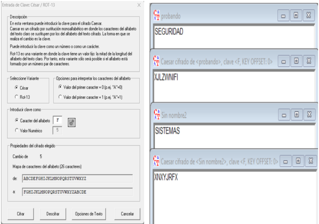
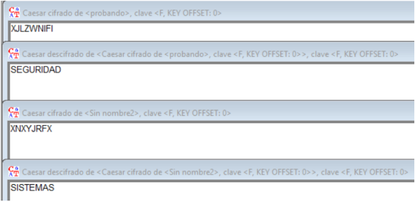
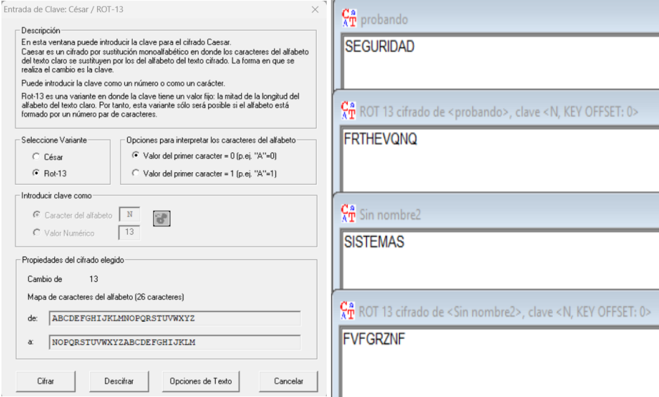
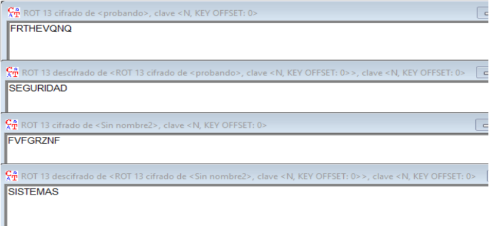
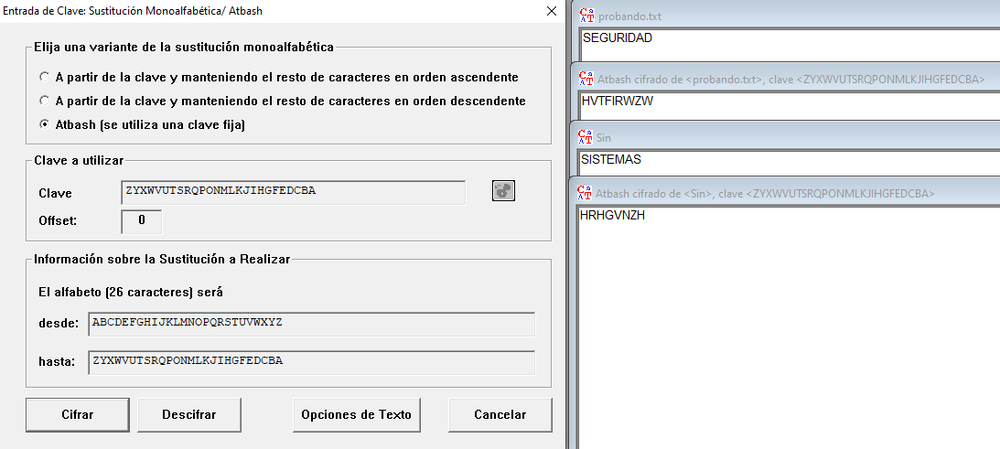
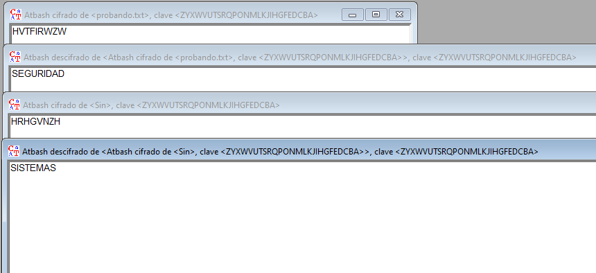
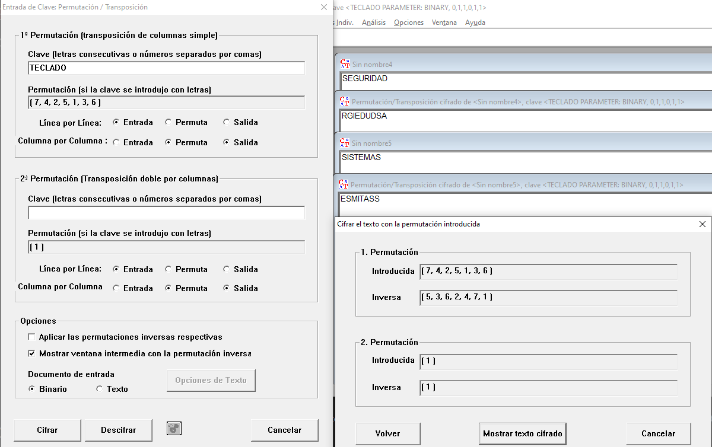
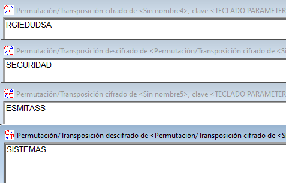
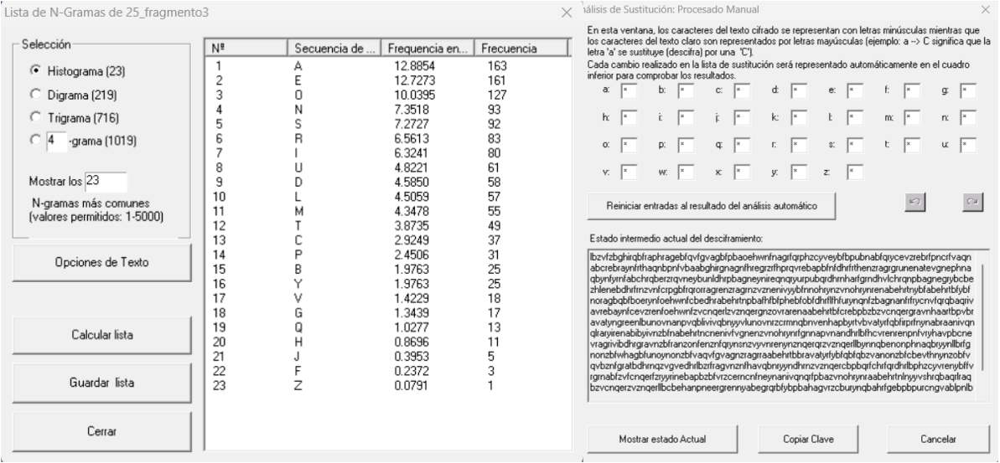

## Ejercicio 1

Instalad CrypTool 1.

### Apartado 1.a

Realizad pruebas de cifrado y descifrado con los siguientes algoritmos: César, Rot-13, Atbash y Trasposición de columnas. Aportad evidencias.

#### Respuesta 1.a

<!-- INICIO RESPUESTA -->

1.CÉSAR

Escogemos una serie de palabras para probar, estas van a ser: seguridad y sistemas. Para la primera prueba decidimos empezar por la letra F. Lo que nos daría este resultado: 

 

Una vez que tenemos las versiones cifradas, vamos a intentar hacer este mismo procedimiento, pero al revés. Para ello cogemos esas versiones cifradas e intentamos volver a las palabras iniciales usando otra vez César empezando por la F. 

 

Si os fijáis, podréis observar cómo sí que llegamos al mismo resultado, y no es la misma ventana que usamos antes, ya que tienen distinto título. 

2.ROT-13 

Ahora vamos a hacer exactamente lo mismo que en el caso anterior, pero ahora con ROT13 que es una versión de César. Es decir, es César con desplazamiento 13. Sería empezando por la letra M.

Volvemos a hacer el paso anterior para descrifrar.

3.ATBASH

El sistema es el mismo pero ahora con Atbash, que utliza una clave fija: ZYXWVUTSRQPONMLKJIHGFEDCBA .

Y lo mismo para descifrar.

4.TRASPOSICIÓN DE COLUMNAS

Para este algoritmo, cogemos las mismas palabras para cifrar y además se necesita una clave: TECLADO. El orden de las columnas es la clave.

Para descifrar, simplemente cogemos el texto cifrado e introducimos la clave que utilizamos para cifrar y volver a ordenar las columnas.

<!-- FIN RESPUESTA -->

### Apartado 1.b

Buscad y documentad las opciones de CrypTool 1 para el criptoanálisis de algoritmos de sustitución monoalfabeto. Estas opciones serán de utilidad para resolver el ejercicio 5.

#### Respuesta 1.b

<!-- INICIO RESPUESTA -->

Con criptoanálisis nos referimos a las técnicas que usamos para romper un cifrado sin conocer su clave. 
Los algoritmos de sustitución monoalfabeto son cifrados que consisten en que cada letra se sustituye siempre por la misma letra. 
Cryptool cuenta con herramientas que nos facilitan el trabajo de intentar romper un cifrado. Algunas de estas herramientas son: 
- N-gramas: que nos muestran cuales son las letras más frecuentes de un texto. 
- Análisis de sustitución: muestra el texto cifrado cambiando las letras que nosotros creemos que sabemos.

<!-- FIN RESPUESTA -->
