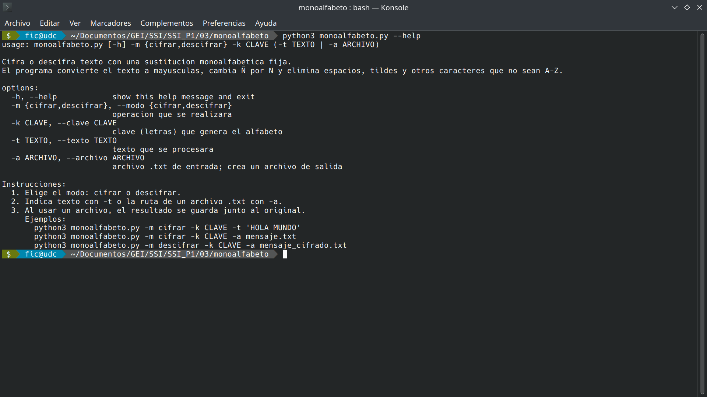

## Ejercicio 3

Diseñad e implementad en Python un algoritmo de cifrado **simétrico** por **sustitución monoalfabeto**.

### Apartado 3.a

Explicad el mecanismo de funcionamiento del algoritmo. Incluid en la explicación un breve ejemplo, paso por paso, de cómo se realizaría el cifrado del texto en claro “MONOALFABETO”.

- El algoritmo sólo utilizará caracteres del alfabeto mostrado en la Tabla 1, tanto en la entrada como en la salida.
- El número de caracteres de salida debe ser el mismo que el número de caracteres de entrada.
- Debéis utilizar los conocimientos adquiridos en clase de teoría, para proponer un algoritmo lo más robusto (y a la vez sencillo) posible.
- La lógica del algoritmo debe ser implementada por vosotros. No es posible hacer uso de funciones ya existentes (como Hash, Encrypt, Rand, etc.).

#### Respuesta 3.a

<!-- INICIO RESPUESTA -->

Podemos redefinir cualquier mecanismo de sustitución monoalfabeto mediante la creación de un "alfabeto cifrado" cuya correspondencia se realiza mediante la posición de las letras. De este modo a la letra 0 (A) del alfabeto normal le corresponde la letra 0 (p.ej. X) del cifrado. 

Por tanto, nuestro objetivo será construir un alfabeto cifrado en base a una clave con una reordenación de las letras. Tratando de que estas no sigan un orden secuencial y no haya correspondencias repetidas. 

Nuestro algoritmo construye un numero coprimo de 26 (para evitar obtener el mismo alfabeto) en base a la clave y usa ese número para obtener la nueva posicion de las letras en el alfabeto cifrado.

Los indices que se usaran van de 1 a 26, no hay 0.

Comenzamos convirtiendo "CLAVE" en un numero sumando los índices de sus letras:
- **3+12+1+22+5 = 43**

A continuación comprobamos que sea coprimo de 26:
- **Es mayor que 26? Sí**
- **Es impar? Sí**
- **No es múltiplo de 13? Sí, no lo es.**

De no cumplir alguna de las condiciones se deberá ajustar el numero:
- **Sumando 26**
- **Sumando 1**
- **Sumando 2**

Ahora vamos a construir el alfabeto cifrado realizando la siguiente operación:

$((PosicionINDICE + 1) * multiplicador) \bmod LongitudAlfabeto$

Al ser un coprimo de 26 está asegurado que no va a haber dos letras en la misma posición.

Ejemplos con la A y M **¡OJO! Aquí indizamos de 0 a 25** :

$$(0(A) + 1) \times 43 \bmod 26 = 17(R)$$
$$(12 (M)+1) \times 43 \bmod 26 = 13(N)$$

Una vez aplicamos esto sobre el alfabeto obtenemos:
- **ABCDEFGHIJKLMNOPQRSTUVWXYZ**
- **RIZQHYPGXOFWNEVMDULCTKBSJA**

Que sera nuestra correspondencia.

Tras ello, cifrar 'MONOALFABETO' será trivial, resultando en:
- **NVEVRWYRIHCV**

<!-- FIN RESPUESTA -->

### Apartado 3.b

El algoritmo debe poder ejecutarse desde una terminal, invocando al comando `monoalfabeto.py` y pasándole los argumentos necesarios.

- El parámetro `--help` debe mostrar la sintaxis y las instrucciones de uso. Mostrad en la memoria una captura de la pantalla que incluya la salida del comando con este parámetro.
- Guardad el código implementado para su posterior entrega en una carpeta denominada `monoalfabeto`.

#### Respuesta 3.b

* [x] Guardado el código fuente `monoalfabeto.py` en la carpeta `03/monoalfabeto` para su entrega con esta memoria 

<!-- INICIO RESPUESTA -->



<!-- FIN RESPUESTA -->

### Apartado 3.c

Cifrad, utilizando el algoritmo implementado, el texto de los archivos `GN_fragmento1.txt` y `GN_fragmento2.txt`. Guardad los textos cifrados para su posterior entrega como `GN_fragmento1_cif.txt` y `GN_fragmento2_cif.txt` respectivamente y subidlos a la carpeta `P1/Retos_Monoalfabeto` en Teams, dentro del plazo indicado (ver nota al final).

- Indicad en la memoria el comando <u>concreto</u> que habéis usado para la operación de cifrado y el que se necesita para la operación de descifrado.

#### Respuesta 3.c

* [X] Cifrado el archivo `GN_fragmento1.txt`, guardado como `03/GN_fragmento1_cif.txt` para su entrega con esta memoria y entregado en Teams en plazo <!-- CASILLA 3.c#1 -->
* [X] Cifrado el archivo `GN_fragmento2.txt`, guardado como `03/GN_fragmento2_cif.txt` para su entrega con esta memoria y entregado en Teams en plazo <!-- CASILLA 3.c#2 -->

<!-- INICIO RESPUESTA -->

Los comandos usados han sido:
```bash
python3 monoalfabeto.py -m cifrar -k VALERON  -a GN_fragmento1.txt 
```
```bash
python3 monoalfabeto.py -m cifrar -k BEBETO  -a GN_fragmento2.txt 
```
Para descifrar:
```bash
python3 monoalfabeto.py -m descifrar -k VALERON  -a GN_fragmento1_cif.txt 
```
```bash
python3 monoalfabeto.py -m descifrar -k BEBETO  -a GN_fragmento2_cif.txt 
```

<!-- FIN RESPUESTA -->
