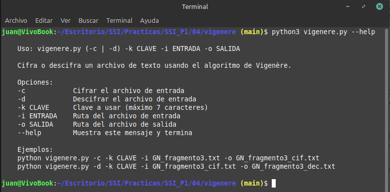
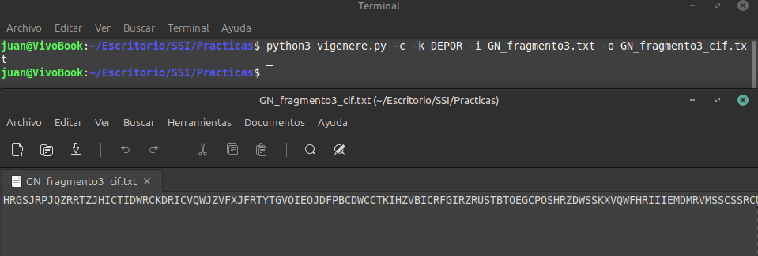
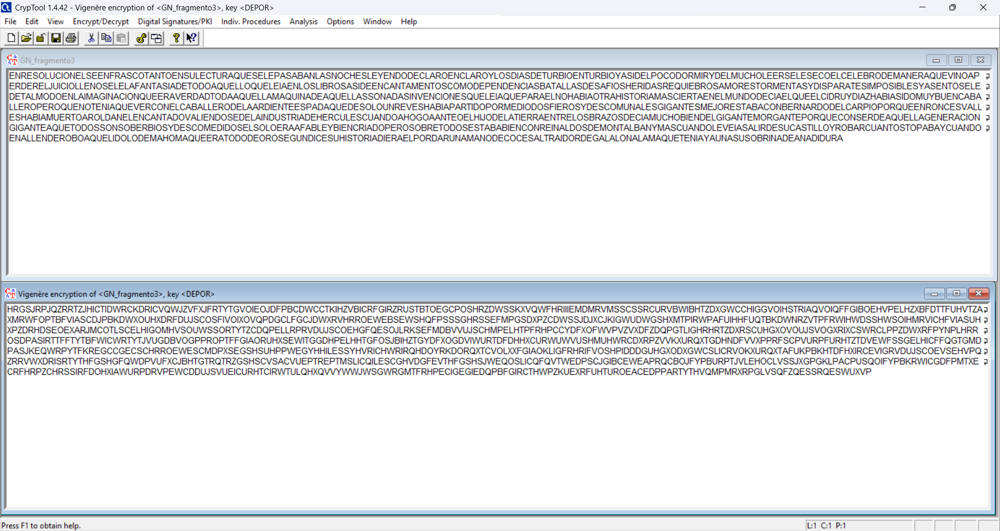
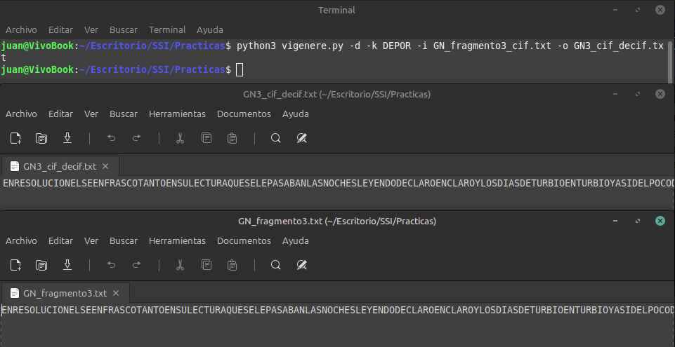

## Ejercicio 4

Implementad en Python el algoritmo de Vigenère.

### Apartado 4.a

Explicad el funcionamiento del código implementado.

- El algoritmo únicamente debe aceptar como entrada caracteres del alfabeto mostrado en la Tabla 1. Esos son también los únicos caracteres válidos para la salida.

#### Respuesta 4.a

<!-- INICIO RESPUESTA -->

Vigenère es un cifrado de sustitución polialfabética: en lugar de desplazar todas las letras con el mismo valor (como César), cada letra del texto en claro se desplaza según la letra de la clave que le corresponde, y la clave se repite cíclicamente a lo largo del texto.

El alfabeto es `ABCDEFGHIJKLMNOPQRSTUVWXYZ` y cada letra se identifica con su posición (A = 0, B = 1, ..., Z = 25). El funcionamiento del código es el siguiente:

1. **Lectura y validación de argumentos** (`validate_args`). Se comprueba que el número de argumentos sea correcto y que se usen las opciones `-c`/`-d`, `-k`, `-i` y `-o` en ese orden. También se comprueba que la clave tenga como máximo 7 caracteres y que el archivo de entrada exista. Si algo falla, se muestra el error y la ayuda de uso.
2. **Validación del texto** (`validate_alpha`). Se lee el archivo de entrada y se comprueba que todos sus caracteres pertenecen al alfabeto de la Tabla 1. Si hay alguno que no pertenece, el programa termina con un error.
3. **Cifrado** (`code_vigenere`). Para la letra *i* del texto, se toma la letra de la clave en la posición *i mod longitud_clave*. La letra cifrada se calcula como:

   `C_i = (T_i + K_(i mod n)) mod 26`

4. **Descifrado** (`decode_vigenere`). Es la operación inversa:

   `T_i = (C_i - K_(i mod n)) mod 26`

5. **Salida**. El resultado se guarda en el archivo indicado con `-o`. La salida tiene la misma longitud que la entrada y sólo contiene letras del alfabeto.

Ejemplo con el texto `HOLA` y la clave `AB` (A = 0, B = 1): H(7)+A(0) = 7 → H; O(14)+B(1) = 15 → P; L(11)+A(0) = 11 → L; A(0)+B(1) = 1 → B. El resultado es `HPLB`.

<!-- FIN RESPUESTA -->

### Apartado 4.b

El algoritmo debe poder ejecutarse desde una terminal, invocando al comando `vigenere.py` y pasándole los argumentos y parámetros necesarios.

- El parámetro `--help` debe mostrar la sintaxis y las instrucciones de uso. Mostrad en la memoria una captura de pantalla que incluya la salida del comando con este parámetro.
- Guardad el código implementado para su posterior entrega en una carpeta denominada `vigenere`.

#### Respuesta 4.b

* [x] Guardado el código fuente `vigenere.py` en la carpeta `04/vigenere` para su entrega con esta memoria <!-- CASILLA 4.b -->

<!-- INICIO RESPUESTA -->



<!-- FIN RESPUESTA -->

### Apartado 4.c

Comprobad con la ayuda de CrypTool 1, que vuestra implementación es correcta y mostrad evidencia de ello.

#### Respuesta 4.c

<!-- INICIO RESPUESTA -->

Para comprobar que la implementación es correcta, ciframos el mismo texto (`GN_fragmento3.txt`) con la misma clave (`DEPOR`) con nuestro programa y con CrypTool 1 (*Encrypt/Decrypt > Symmetric (classic) > Vigenère*), y comparamos los resultados.

Cifrado con nuestro programa:



Cifrado con CrypTool 1:



En ambos casos el criptograma comienza por `HRGSJRPJQZRRTZJHICTIDWRCKDRICVQWJZVFXJFRTYTGVOIEOJDFPBCDWCCTK...` y termina igual, por lo que el resultado es idéntico.

También comprobamos que el descifrado devuelve el texto original, comparando el resultado de `-d` con `GN_fragmento3.txt`:



<!-- FIN RESPUESTA -->

### Apartado 4.d

Cifrad, utilizando el algoritmo implementado, el texto del archivo `GN_fragmento3.txt`. Guardad el texto cifrado como `GN_fragmento3_cif.txt` y subidlo a la carpeta `P1/Retos_Vigenere` en Teams, dentro del plazo indicado (ver nota al final).

- Indicad en la memoria el comando <u>concreto</u> que habéis usado para la operación de cifrado y el que se necesita para la operación de descifrado.
- La clave puede tener, como máximo, 7 caracteres.

#### Respuesta 4.d

* [x] Cifrado el archivo `GN_fragmento3.txt`, guardado como `04/GN_fragmento3_cif.txt` para su entrega con esta memoria y entregado en Teams en plazo <!-- CASILLA 4.d -->

<!-- INICIO RESPUESTA -->

Los comandos usados han sido (clave `DEPOR`, de 5 caracteres):

Para cifrar:
```bash
python3 vigenere.py -c -k DEPOR -i GN_fragmento3.txt -o GN_fragmento3_cif.txt
```
Para descifrar:
```bash
python3 vigenere.py -d -k DEPOR -i GN_fragmento3_cif.txt -o GN_fragmento3_dec.txt
```

<!-- FIN RESPUESTA -->
