## Ejercicio 5

Seleccionad dos fragmentos de la carpeta `P1/Retos_Monoalfabeto` en Teams.

### Apartado 5.a

En la memoria debéis indicar el nombre de los fragmentos seleccionados, pero no es necesario incluirlos.

#### Respuesta 5.a

<!-- INICIO RESPUESTA -->

Fragmentos escogidos 2.3 y 2.4

<!-- FIN RESPUESTA -->

### Apartado 5.b

Tratad de obtener el texto en claro correspondiente, <u>aplicando análisis de frecuencias</u>. <u>Indicad los pasos</u> que habéis seguido. Se valora la explicación y justificación del proceso. Dicho proceso <u>no puede automatizarse</u> con el uso de herramientas existentes. Aunque sí pueden utilizarse herramientas para los cálculos intermedios necesarios.

#### Respuesta 5.b

<!-- INICIO RESPUESTA -->

#### Primer fragmento
Resultados del análisis de frecuencias para letras:

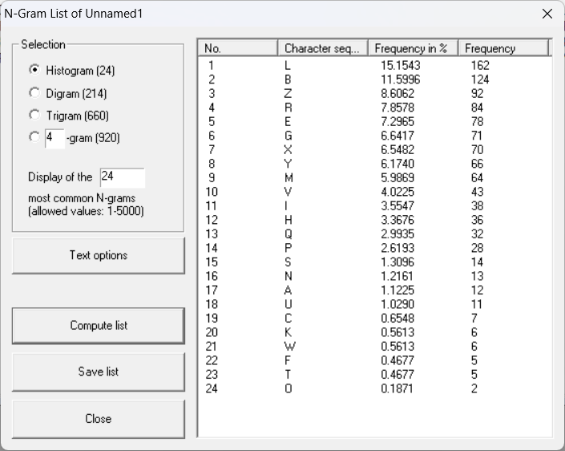

Resultados del análisis de frecuencias para digramas:

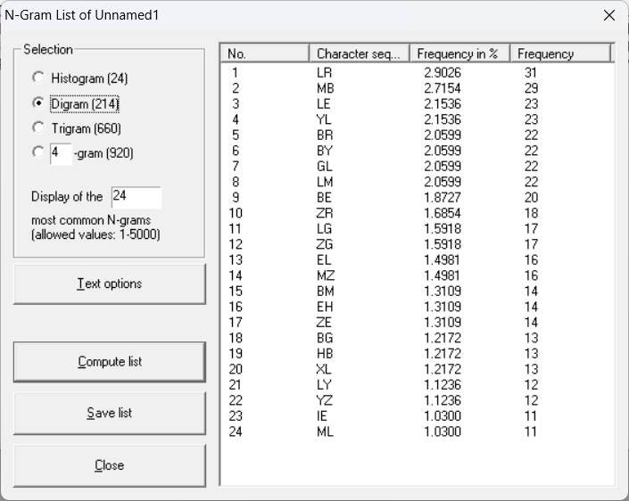

Resultados del análisis de frecuencias para trigramas:

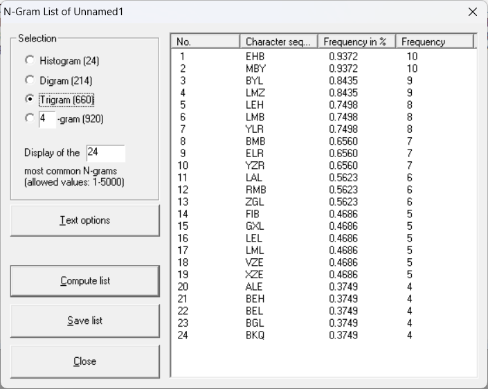

Resultados del análisis de frecuencias para cuatrigramas:
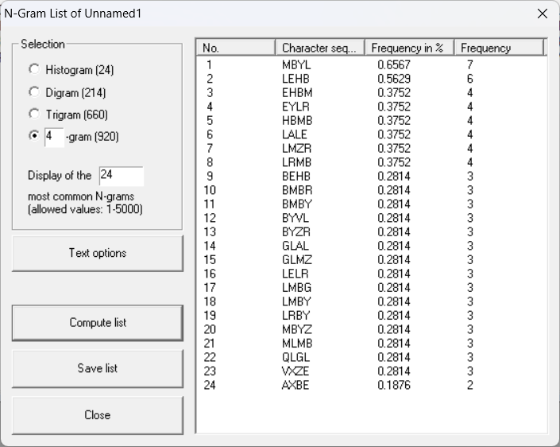


Como referencia usamos las frecuencias de [Practical Cryptography](http://practicalcryptography.com/cryptanalysis/letter-frequencies-various-languages/spanish-letter-frequencies/?utm_source=chatgpt.com), calculadas a partir de unos 90 millones de caracteres de español del corpus Wortschatz. 

Iniciamos con `E A O S R N`. Probamos la `l -> E` y `l -> A`. Decidimos la primera por tener más digramas que cuadren.

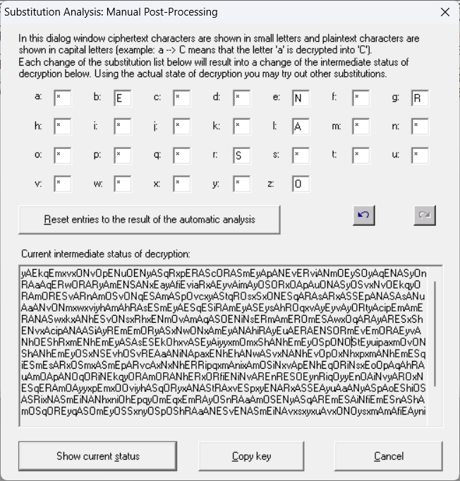

Hay un digrama `ON` en la primera línea que resulta de utilidad si probamos con un cuatrigrama común `CION`nos revela una palabra como `ApANECER` por ende `p -> M`

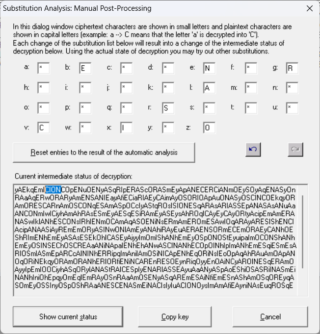

Nos fijamos ahora en el resultado y la primera frase se intuye: `LA EXPEDICION COMENZÓ EN LAS PRIMERAS HORAS`

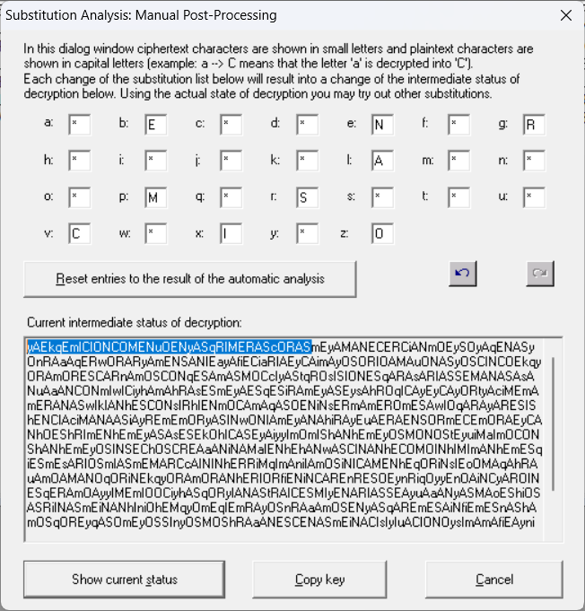

Seguimos introduciendo las hipótesis:
`y -> L`, `k -> X`, `q -> P`, `m -> D`, `u -> Z` y `c -> H`

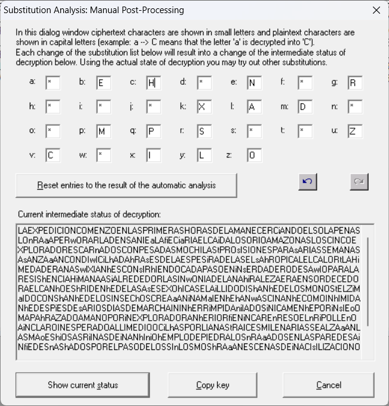

Y a partir de este punto la solución es trivial pues ya se ve a simple vista.

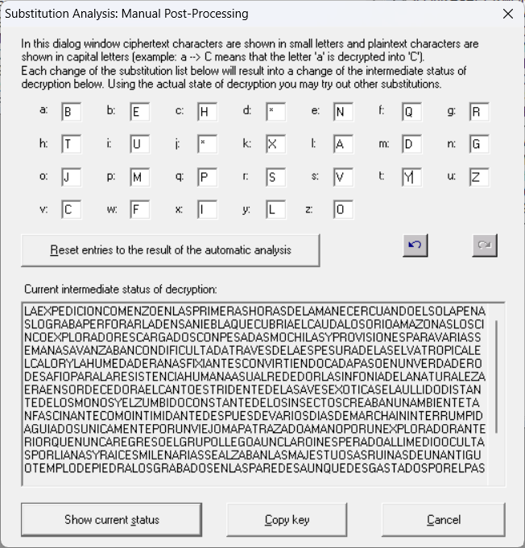


#### Segundo fragmento

**Fragmento analizado:** `2.3_fragmento2_cif.txt`. Tiene 1036 caracteres, sin espacios ni signos de puntuación, y 24 letras distintas (no aparecen D ni J). El texto en claro está en castellano y el cifrado es una sustitución monoalfabética simple. Las herramientas se han usado solo para calcular frecuencias (histograma, digramas y trigramas); las hipótesis y las sustituciones se han hecho a mano.


#### Primeras hipótesis basadas en las frecuencias

Apoyo gráfico: frecuencias de digramas y trigramas obtenidas con la herramienta.

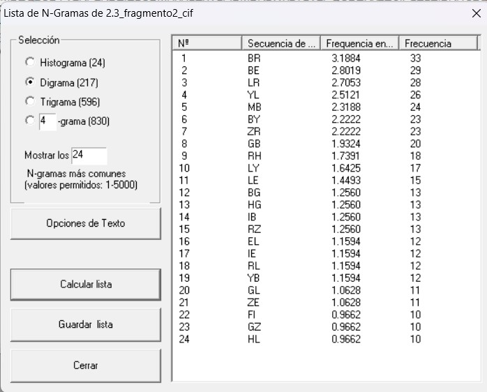

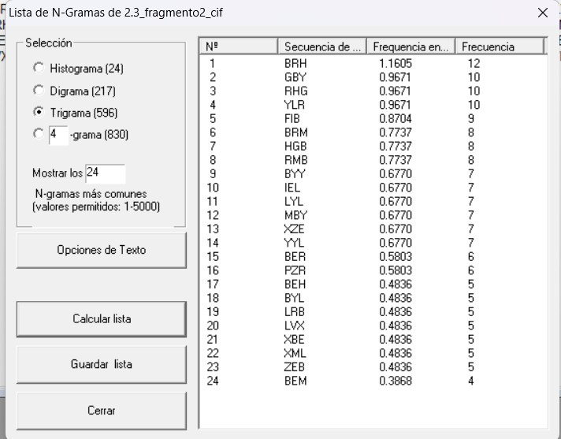

**Hipótesis 1: B = e, L = a**

* Por qué: B y L son las dos letras más frecuentes (13,8 % y 12,3 %), igual que E y A en castellano. Los frecuentes BR, BE, LR y LE encajan con "es", "en", "as" y "an".

**Hipótesis 2: R = s, Z = o**

* Por qué: R es la tercera (9,8 %) y Z la cuarta (8,9 %), igual que S y O en castellano. Además, "ZR" aparece 23 veces y encaja con "os", la terminación plural más común.

Se introducen estas cuatro sustituciones (b→E, l→A, r→S, z→O) en el análisis de sustitución manual:

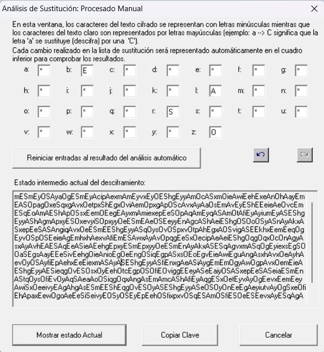

#### 2º Viendo el inicio del texto: `mESmEyOS`

Con las hipótesis anteriores, el inicio del texto cifrado `MBRMBYZR` queda como `mESmEyOS` (minúsculas = letras del cifrado aún sin sustituir, mayúsculas = texto en claro).

**Hipótesis 3: M = d, Y = l**

* Por qué (inicio del texto): el patrón `_ES_E_OS` tiene la primera letra repetida en la posición 4 (M) y la segunda en la posición 5 (E). La palabra `DESDE` encaja perfectamente (d-e-s-d-e), y a continuación `LOS` (Y-Z-R). Es el comienzo más natural del castellano ("Desde los…").
* Por qué (digramas): con M = d, MB = "de" (24 apariciones, 5º digrama) y con Y = l, YL = "la" (26, 4º), BY = "el" (23, 6º) y LY = "al" (17, 10º). Todos son digramas muy frecuentes del castellano.
* Por qué (trigramas): MBY = "del" (7), YLR = "las" (10), BRM = "es d" y RMB = "s de" (8 cada uno, típicos de "…es de…", "…s de…"). BYY = "ell" y YYL = "lla" (7 cada uno) incluyen la doble YY = "ll", que es muy rara en castellano y refuerza Y = l.
* El texto empieza ya con `DESDE LOS`.

#### 3º Hipótesis para ir rellenando el resto de sustituciones

**Hipótesis 4: E = n, I = u, F = q**

* Por qué: BE = "en" (29) y LE = "an" (15) son digramas frecuentes. IE (12) = "un". El trigrama FIB (9) = "que", que además es una conjunción muy frecuente y la q siempre va con u.

**Hipótesis 5: H = t, G = r (palabra `BRHGBYYLR` = "estrellas")**

* Por qué: los trigramas más frecuentes BRH (12), RHG (10), GBY (10) e YLR (10) se solapan en la secuencia `BRHGBYYLR`, que aparece 5 veces. Con lo ya aceptado se lee `es?r?ellas`, con la doble YY = ll, así que solo puede ser **"estrellas"**: H = t, G = r. Además, la primera aparición va tras `DESDELOSAL…` y el texto habla del cielo.

**Hipótesis descartada: X = c**

* Por qué se propuso: el trigrama XZE (7) parecía "con".
* Por qué se descartó: al sustituir, `CIPLEXMLM` quedaba `?u?an?dad`, ilegible. Esa secuencia solo se lee bien como "humanidad". Eso implica X = i (y por tanto XZE = "ion", terminación -ción, frecuente) y C = h, P = m.
* Descartada; se acepta X = i.

**Hipótesis 6: X = i, V = c, C = h, P = m**

* Por qué: `CIPLEXMLM` = "humanidad" (C = h, P = m, X = i) y `VXBYZ` = "cielo" (V = c). Con esto `DESDE LOS AL?ORES DE LA HUMANIDAD EL CIELO ESTRELLADO…` ya tiene sentido.

Estado del descifrado tras estas hipótesis (las letras mayúsculas del cifrado aún sin sustituir se muestran tal cual):

```
desdelosalAoresdelahumanidadelcieloestrelladohasidounaWuenteinaNotaAledeasoPAroinsQiracionTPisterio...
```

A partir de este punto el texto es medianamente legible y el resto fue un proceso de completar por contexto. Cada hueco se resuelve viendo la palabra en la que está:

| Cifrado | Palabra que aparece | Sustitución |
|---|---|---|
| A | al**b**ores | A = b |
| N | ina**g**otable | N = g |
| W | **f**uente | W = f |
| Q | ins**p**iración | Q = p |
| T | inspiración **y** misterio | T = y |
| S | **v**iendo, **v**iolento | S = v |
| O | des**p**e**j**ada, **j**ojos | O = j |
| U | la l**uz** de las estrellas | U = z |
| K | se e**x**tienden | K = x |

Con eso se obtiene un texto con sentido completo (apartado 5.c) y se verifica que la sustitución es biyectiva (sin letras repetidas en el alfabeto de cifrado).

<!-- FIN RESPUESTA -->

### Apartado 5.c

Mostrad el texto descifrado.

#### Respuesta 5.c

<!-- INICIO RESPUESTA -->
#### Fragmento 1

```txt
LAEXPEDICIONCOMENZOENLASPRIMERASHORASDELAMANECERCUANDOELSOLAPENASLOGRABAPERFORARLADENSANIEBLAQUECUBRIAELCAUDALOSORIOAMAZONASLOSCINCOEXPLORADORESCARGADOSCONPESADASMOCHILASYPROVISIONESPARAVARIASSEMANASAVANZABANCONDIFICULTADATRAVESDELAESPESURADELASELVATROPICALELCALORYLAHUMEDADERANASFIXIANTESCONVIRTIENDOCADAPASOENUNVERDADERODESAFIOPARALARESISTENCIAHUMANAASUALREDEDORLASINFONIADELANATURALEZAERAENSORDECEDORAELCANTOESTRIDENTEDELASAVESEXOTICASELAULLIDODISTANTEDELOSMONOSYELZUMBIDOCONSTANTEDELOSINSECTOSCREABANUNAMBIENTETANFASCINANTECOMOINTIMIDANTEDESPUESDEVARIOSDIASDEMARCHAININTERRUMPIDAGUIADOSUNICAMENTEPORUNVIEJOMAPATRAZADOAMANOPORUNEXPLORADORANTERIORQUENUNCAREGRESOELGRUPOLLEGOAUNCLAROINESPERADOALLIMEDIOOCULTASPORLIANASYRAICESMILENARIASSEALZABANLASMAJESTUOSASRUINASDEUNANTIGUOTEMPLODEPIEDRALOSGRABADOSENLASPAREDESAUNQUEDESGASTADOSPORELPASODELOSSIGLOSMOSTRABANESCENASDEUNACIVILIZACIONOLVIDADAQUEALGUNAVEZPROSPEROENARMONIACONLASELVAELLIDERDELAEXPEDICIONSACOSUCUADERNODENOTASYCOMENZOADOCUMENTARCADADETALLESABIENDOQUEESTEHALLAZGOPODRIACAMBIARPARASIEMPRELAHISTORIADELAREGION
```

#### Fragmento 2

```txt
desdelosalboresdelahumanidadelcieloestrelladohasidounafuenteinagotabledeasombroinspiracionymisteriocuandomiramoshacialabovedacelesteenunanochedespejadaestamosviendoenrealidaduninmensomapadelpasadoyaquelaluzdelasestrellastardamilesoinclusomillonesdeanosenllegarhastanuestrosojoslasgalaxiasinmensasagrupacionesdeestrellaspolvocosmicoymateriaoscuraseextiendenporelcosmosenunaredtitanicaquedesafialacomprensionhumananuestropropiohogarlavialacteaesapenasunaentremilesdemillonesdegalaxiasesparcidasporeluniversoobservableensucentrounagujeronegrosupermasivoejerceunafuerzagravitacionaltancolosalquemantieneunidasalasestrellasquegiranasualrededorlaformaciondeunaestrellaesunprocesoviolentoyhermosoqueocurreenlasnebulosasinmensasnubesdegasypolvoquecolapsanbajosupropiagravedadhastaquelapresionyelcalorenciendenlafusionnuclearatravesdeesteprocesolasestrellasnosologeneranluzycalorsinoquetambienforjanensusnucleosloselementosquimicospesadosquesonesencialesparalaexistenciadelavidasomospolvodeestrellastratandodecomprendereluniversodelcualemergimos
```


<!-- FIN RESPUESTA -->

### Apartado 5.d

Indicad la clave de sustitución.

#### Respuesta 5.d

<!-- INICIO RESPUESTA -->

`LAVMBWNCXO*YPEZQFGRHIS*KTU`


<!-- FIN RESPUESTA -->

### Apartado 5.e

Explicad, si es posible, el funcionamiento del algoritmo de cifrado analizado.

#### Respuesta 5.e

<!-- INICIO RESPUESTA -->

Si observamos la clave y numeramos las letras obtenemos lo siguiente:

`12, 1, 22, 13, 2, 23, 14, 3, 24, 15, *, 25, 16, 5, 26, 17, 6, 7, 18, 8, 9, 19, *, 11, 20, 21`

Y aqui vemos un patrón bastante claro: 
los numeros consecutivos están separados por 3 posiciones (12 _ _ 13)

Desconocemos como se pasa de la palabra clave al alfabeto de cifrado.


<!-- FIN RESPUESTA -->
