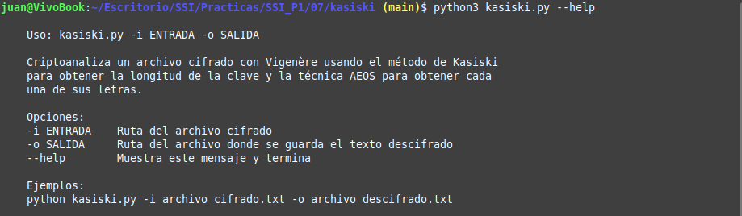
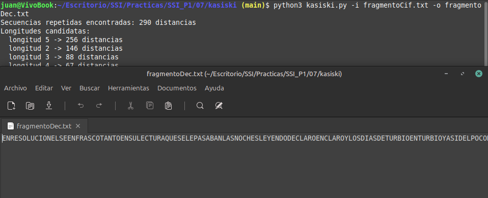
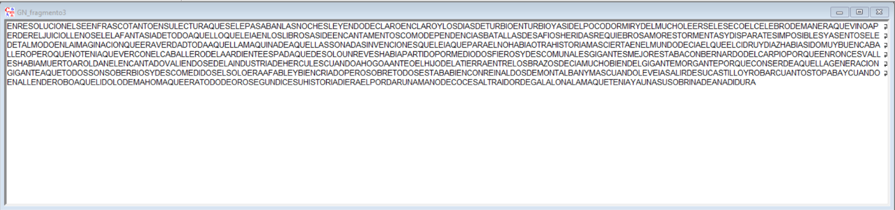

## Ejercicio 7

Implementad en Python una herramienta que automatice lo máximo posible el criptoanálisis usando Kasiski, haciendo uso de la técnica AEOS.

### Apartado 7.a

Explicad el funcionamiento del código implementado.

#### Respuesta 7.a

<!-- INICIO RESPUESTA -->

La herramienta recibe un archivo cifrado con Vigenère y obtiene de forma automática la longitud de la clave, la clave y el texto en claro. Se ejecuta con `python3 kasiski.py -i ENTRADA -o SALIDA`. El funcionamiento del código es el siguiente:

1. **Validación** (`validate_args`, `validate_alpha`). Se comprueban los argumentos y que el criptograma sólo contenga letras del alfabeto de la Tabla 1.
2. **Test de Kasiski** (`find_distances`). Se recorre el texto y, para cada secuencia de 3 caracteres (`LONG_MIN`) que aparece más de una vez, se calculan las distancias entre todas sus apariciones. Una misma secuencia de texto en claro cifrada con la misma parte de la clave da la misma secuencia cifrada, por lo que esas distancias suelen ser múltiplos de la longitud de la clave.
3. **Candidatas a longitud de clave** (`key_length_candidates`). Para cada longitud posible entre 2 y 7 (`LONG_MAX`, que es el máximo permitido para la clave) se cuenta cuántas distancias son divisibles entre ella. Las longitudes se ordenan de más a menos distancias divisibles y, a igualdad, se prefiere la más corta (así, si 5 y 10 dividen el mismo número de distancias, se da preferencia a 5).
4. **Subcriptogramas** (`subcryptograms`). Para cada longitud candidata *n*, se divide el criptograma en *n* subtextos: el subtexto *i* contiene las letras en las posiciones *i, i+n, i+2n...* Cada subtexto está cifrado con una única letra de la clave, es decir, con un César.
5. **Técnica AEOS** (`aeos`). En español las letras más frecuentes son A, E, O y S. Para cada subtexto se calculan las frecuencias de las letras (`frequencies`) y se toman las 3 letras más frecuentes del cifrado. Cada una de ellas se prueba como si fuese una de A, E, O o S, lo que da un desplazamiento. Para ese desplazamiento se miran las posiciones donde deberían aparecer las otras tres letras, y se comprueba que su frecuencia supera un umbral (`longitud del subtexto / 26`, la frecuencia media de una letra). Si las tres lo superan, la hipótesis es válida. Si hay varias hipótesis válidas, se elige la de mayor suma de frecuencias. El desplazamiento es la letra de la clave. Si ninguna hipótesis es válida, la longitud se descarta.
6. **Elección de la mejor clave** (`find_key`, `score_aeos`). Para cada longitud candidata en la que AEOS ha funcionado en todos los subtextos, se descifra el texto con la clave obtenida y se puntúa contando cuántas A, E, O y S aparecen en el resultado. Se elige la clave con mayor puntuación.
7. **Salida** (`decode_vigenere`). Se muestra por pantalla la longitud candidata, la clave y su puntuación, y se guarda en el archivo `SALIDA` el texto descifrado con la mejor clave.

<!-- FIN RESPUESTA -->

### Apartado 7.b

El algoritmo debe poder ejecutarse desde una terminal, invocando al comando `kasiski.py` y pasándole los argumentos y parámetros necesarios.

- El parámetro `--help` debe mostrar la sintaxis y las instrucciones de uso. Mostrad en la memoria una captura de pantalla que incluya la salida del comando con este parámetro.
- Guardad el código implementado para su posterior entrega en una carpeta denominada `kasiski`.

#### Respuesta 7.b

* [x] Guardado el código fuente `kasiski.py` en la carpeta `07/kasiski` para su entrega con esta memoria <!-- CASILLA 7.b -->

<!-- INICIO RESPUESTA -->

<!-- FIN RESPUESTA -->

### Apartado 7.c

Comprobad con la ayuda de CrypTool 1, que vuestra implementación es correcta y mostrad evidencia de ello.

#### Respuesta 7.c

<!-- INICIO RESPUESTA -->

Para comprobar que la implementación es correcta usamos el criptograma de `GN_fragmento3` (cifrado con la clave `DEPOR`) y lo criptoanalizamos con nuestra herramienta. Obtiene como longitud de clave 5, que es la que más distancias divide (256 de 290), y descifra el texto:

Después, comparamos con el texto en claro que se obtiene en CrypTool 1 para el mismo fragmento:

Ambos textos coinciden: empiezan por `ENRESOLUCIONELSEENFRASCOTANTOENSULECTURA...` y terminan en `...AUNASUSOBRINADEANADIDURA`, así que la herramienta obtiene el texto correcto.

<!-- FIN RESPUESTA -->
