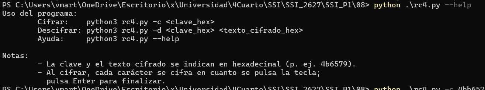
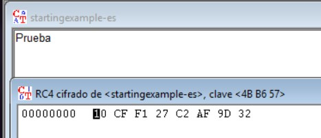
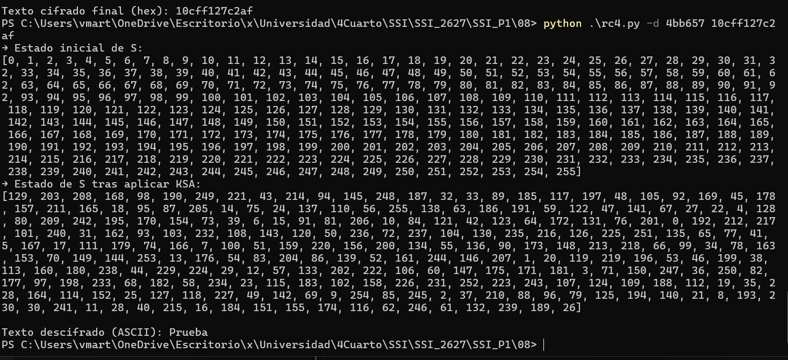

## Ejercicio 8

Implementad en Python el algoritmo RC4, <u>con las siguientes consideraciones</u>:

- Al ejecutar el algoritmo, debe mostrarse por pantalla el <u>valor inicial de S</u>, el <u>valor de S después de la fase inicial</u> y <u>cómo va cambiando S con la generación del</u> *<u>keystream</u>*. La representación de los valores de S debe hacerse en formato decimal.
- Para el cifrado:
  - La clave de cifrado debe introducirse en formato hexadecimal.
  - El texto a cifrar debe irse leyendo por consola e irse cifrando, carácter a carácter, con cada pulsación del teclado.
  - Los caracteres introducidos se interpretarán como ASCII.
  - Para cada carácter introducido, se mostrará: 1) su codificación en ASCII y en binario, 2) el valor del *keystream* en decimal y en binario y 3) el resultado de la operación de cifrado en binario y en hexadecimal.
  - Finalizado el proceso de cifrado, se mostrará el resultado completo del texto cifrado, en formato hexadecimal.
- Para el descifrado:
  - El texto a descifrar se introducirá por consola en formato hexadecimal. Todo el texto de una vez.
  - En este caso no se mostrarán los pasos intermedios como en el cifrado, sino que se mostrará directamente el texto descifrado, en formato ASCII.

### Apartado 8.a

El algoritmo debe poder ejecutarse desde una terminal, invocando al comando `rc4.py` y pasándole los argumentos y parámetros necesarios.

- El parámetro `--help` debe mostrar la sintaxis y las instrucciones de uso. Mostrad en la memoria una captura de pantalla que incluya la salida del comando con este parámetro.
- Guardad el código implementado para su posterior entrega en una carpeta denominada `rc4`.

#### Respuesta 8.a

* [x] Guardado el código fuente `rc4.py` en la carpeta `08/rc4` para su entrega con esta memoria <!-- CASILLA 8.a -->

<!-- INICIO RESPUESTA -->

El algoritmo se ha implementado en `rc4.py` y se ejecuta desde la terminal:

- Cifrar: `python3 rc4.py -c <clave_hex>`. El texto se introduce tecla a tecla y cada carácter se cifra al pulsarla; con Enter finaliza y se muestra el texto cifrado completo en hexadecimal.
- Descifrar: `python3 rc4.py -d <clave_hex> <texto_cifrado_hex>`.
- Ayuda: `python3 rc4.py --help`.

La clave se valida antes de ejecutar nada: debe estar en hexadecimal, con un número par de dígitos (cada pareja es un byte) y tener entre 1 y 256 bytes. En caso contrario se muestra un error junto con la sintaxis de uso.

Salida del comando con el parámetro `--help`:



<!-- FIN RESPUESTA -->

### Apartado 8.b

Comprobad con la ayuda de CrypTool 1, que vuestra implementación es correcta y mostrad evidencia de ello.

#### Respuesta 8.b

<!-- INICIO RESPUESTA -->

Se ha cifrado con la implementación el texto `Prueba` con la clave `4bb657` (en CrypTool, `4B B6 57`) y se ha comparado con el cifrado RC4 de CrypTool 1 sobre el mismo texto y la misma clave.

Resultado de `python3 rc4.py -c 4bb657` tecleando `Prueba`:

```
Texto cifrado final (hex): 10cff127c2af
```

Resultado de CrypTool 1 (Cifrar/Descifrar > Simétrico (moderno) > RC4):



Los seis primeros bytes (`10 CF F1 27 C2 AF`) coinciden exactamente en ambas implementaciones. CrypTool muestra dos bytes más (`9D 32`) porque el documento de CrypTool contiene, además de `Prueba`, un salto de línea (CR+LF, `0D 0A`) al final. Se ha comprobado que esos dos bytes son justamente `0D` y `0A` cifrados con los bytes 7 y 8 del keystream (`90` y `38`): `9D ⊕ 90 = 0D` y `32 ⊕ 38 = 0A`. Por tanto, la implementación es correcta.

Además, el descifrado con `python3 rc4.py -d 4bb657 10cff127c2af` devuelve `Prueba`.



<!-- FIN RESPUESTA -->
