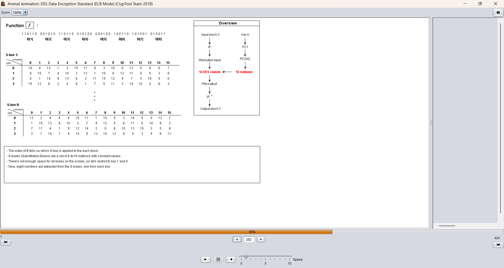
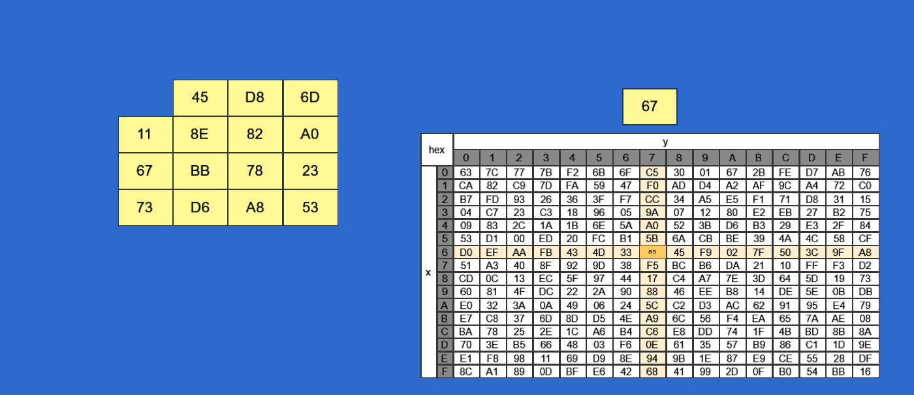
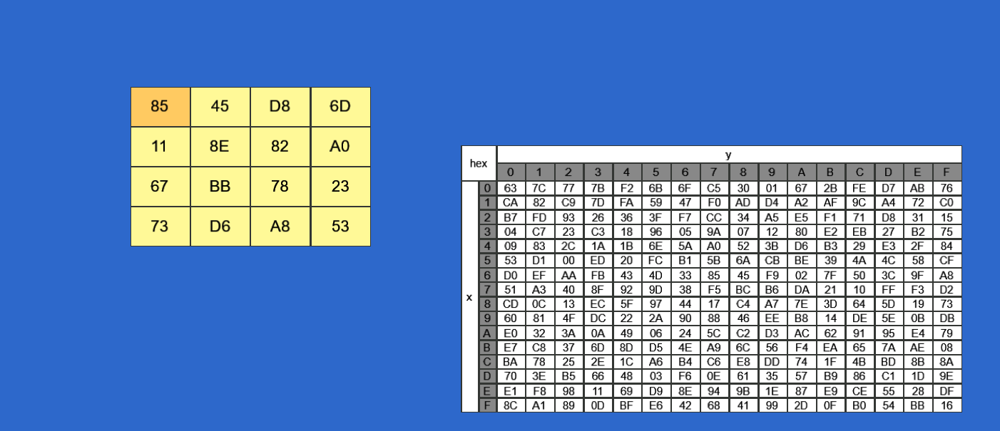

## Ejercicio 9

Revisad las animaciones de DES y AES en CrypTool, con el objetivo de comprender su funcionamiento general.

- La animación de DES puede lanzarse en CrypTool 1 en Procedimientos Indiv. > Visualización de algoritmos > DES
- Aunque CrypTool 1 también incluye una animación para AES, es una implementación antigua y es posible que no funcione en vuestros equipos. Hay una versión actualizada, disponible en [CrypTool online](https://www.cryptool.org/en/cto/aes-animation).

### Apartado 9.a

¿En qué estructura se realizan las operaciones de sustitución en DES? Indicad y aportad captura de pantalla.

#### Respuesta 9.a

<!-- INICIO RESPUESTA -->

Las sustituciónes se realizan en base a las S-boxes (cajas de sustitución).

Durante la función de ronda, el bloque de datos de 32 bits expandido a 48 bits se divide en 8 subbloques de 6 bits. 

A cada subbloque le corresponde una S-box. Estas a su vez son matrices 4x16 con valores de 4 bits de las cuales se seleccionara un número en base a los bits de cada subbloque que será el sustituto de los 6 bits del subbloque.

<!-- FIN RESPUESTA -->

### Apartado 9.b

¿Y en AES? Indicad y aportad captura de pantalla.

#### Respuesta 9.b

<!-- INICIO RESPUESTA -->

En el algoritmo AES, las operaciones de sustitución se realizan en la fase llamada SubBytes. Durante esta etapa, cada byte del estado de 4x4 dentro de la state matrix (bloque de 128 bits organizado en un byte por fila y columna) se sustituye de forma independiente por otro byte utilizando una tabla fija denominada S-Box de AES.

<!-- FIN RESPUESTA -->

### Apartado 9.c

Con respecto a la arquitectura, ¿cuál es la diferencia principal entre ambos algoritmos?

#### Respuesta 9.c

<!-- INICIO RESPUESTA -->

DES utiliza una Red Feistel: Divide el bloque de 64 bits en dos mitades iguales. En cada una de las 16 rondas, la transformación no lineal (F) se aplica únicamente a una de las mitades y se combina mediante XOR con la otra antes de intercambiarlas.

AES utiliza una Red de Sustitución-Permutación: No utiliza un esquema de Feistel, sino que opera simultáneamente sobre la totalidad del bloque de 128 bits organizado en una matriz de estado de 4x4 bytes. En cada ronda aplica cuatro transformaciones a todos sus elementos de forma paralela: AddRoundKey, SubBytes, ShiftRows y MixColumns.

<!-- FIN RESPUESTA -->
