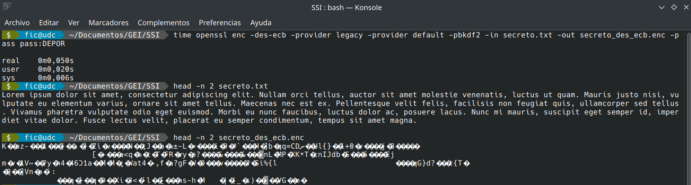
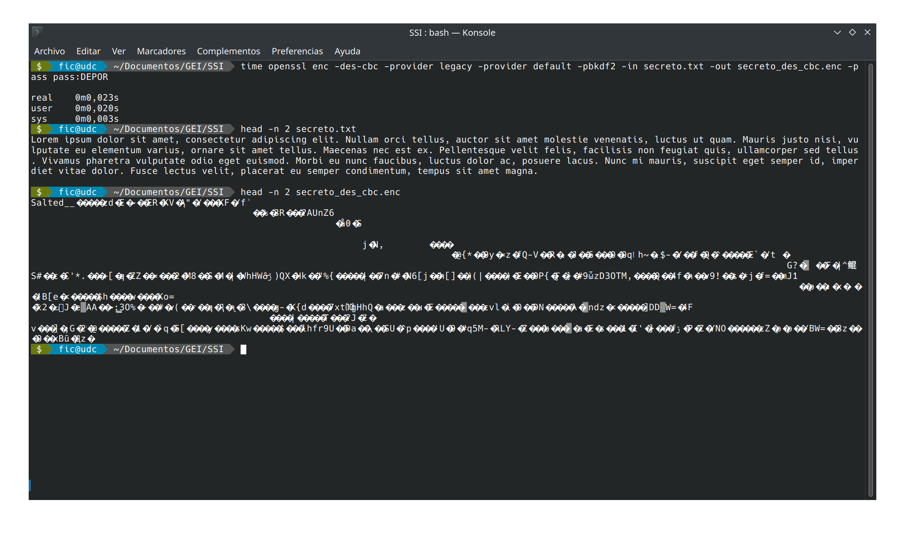
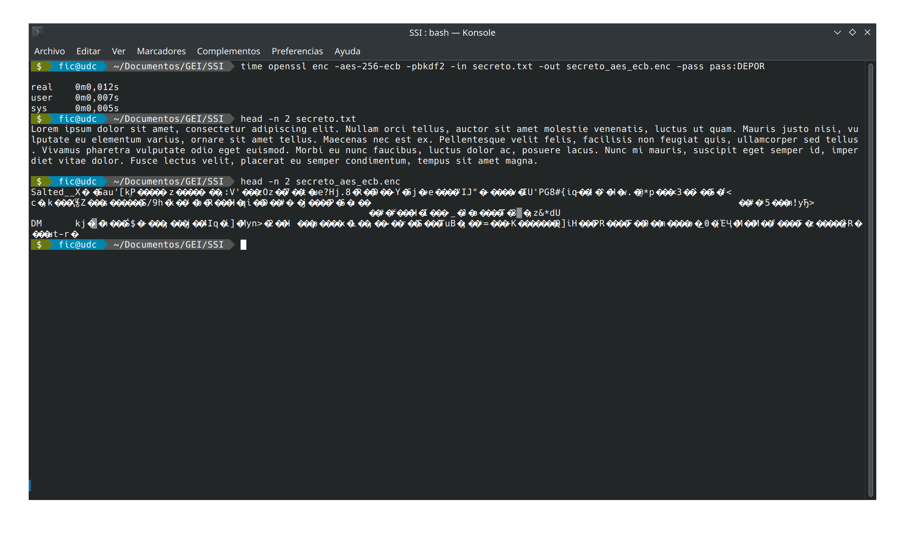
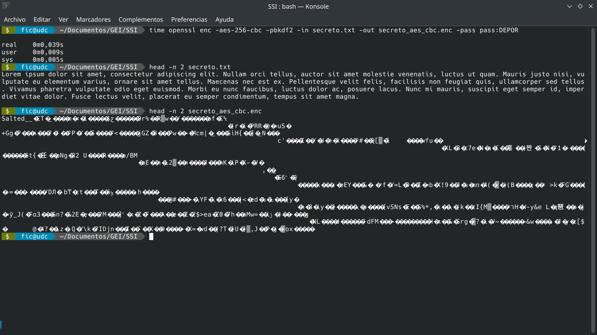
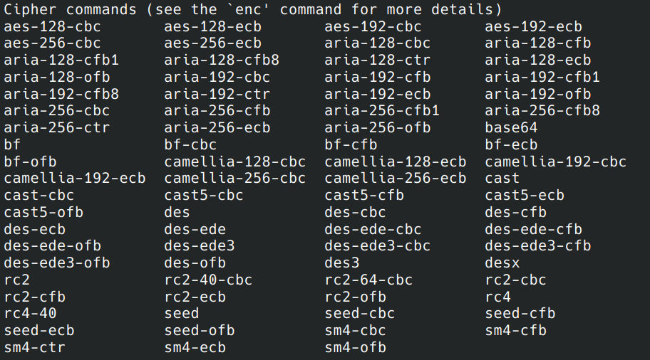

## Ejercicio 10

Utilizando OpenSSL:

### Apartado 10.a

Indicad los comandos necesarios para cifrar el archivo `secreto.txt` con el algoritmo DES utilizando una clave de 64 bits y con el algoritmo AES, utilizando una clave de 256 bits, haciendo uso de los modos ECB primero y CBC después. Mostrad evidencias del proceso. Indicad el tiempo que tarda en ejecutarse cada comando.

#### Respuesta 10.a

<!-- INICIO RESPUESTA -->
Se ha consultado a Gemini 3.6 Flash para aprender el funcionamiento de OpenSSL (no se adjunta prompt por ser una conversación extensa).

Se han comprendido los comandos y se podrá demostrar en la defensa. 

La respuesta a este y subsiguientes ejercicios NO está escrita usando IA.

Vamos a construir los comandos y mostraremos el resultado al final:

**¿Que operación queremos hacer?**
- `enc` indica "encode" o "encryption" y agrupa las rutinas de cifrado simétrico

**¿Vamos a usar un algoritmo obsoleto?**

- `-provider legacy -provider default` para indicar a OpenSSL que cargue ese modulo de compatibilidad para algoritmos antiguos (DES)

**¿Que algoritmo y modo queremos usar?**

- `des-ecb` seleccionamos DES con modo ECB
  - Requiere ``
  - ¿Sin contraseña interactiva?
    - `-K <clave>` adjuntamos clave hex
    - Otra opcion: `-pass pass:<contraseña>` para pasarla directamente
    - Si no, pide contraseña
- `des-cbc` seleccionamos DES con modo CBC 
  - ¿Sin contraseña interactiva?
    - `-K <clave>` adjuntamos clave hex
    - `-IV <vector>` adjuntamos vector de inicialización 
    - Otra opcion: `-pass pass:<contraseña>` para pasarla directamente
- `aes-256-ecb` seleccionamos AES con 256 bits y modo ECB
  - ¿Sin contraseña interactiva?
    - `-K <clave>` adjuntamos clave hex
    - Otra opcion: `-pass pass:<contraseña>` para pasarla directamente
    - Si no, pide contraseña
- `aes-256-cbc` seleccionamos AES con 256 bits y modo CBC
  - ¿Sin contraseña interactiva?
    - `-K <clave>` adjuntamos clave hex
    - `-IV <vector>` adjuntamos vector de inicialización 
    - Otra opcion: `-pass pass:<contraseña>` para pasarla directamente
    - Si no, pide contraseña

- `pbkdf2` parametro requerido por versiones modernas de OpenSSL para generar la clave en base a la contraseña introducida hay que usarlo si se usa `-pass` o si se va a introducir de forma interactiva.

Resultado y tiempos medidos con `time`:
```bash
#DES-ECB: 23 ms
openssl enc -des-ecb -provider legacy -provider default -pbkdf2 -in secreto.txt -out secreto_des_ecb.enc -pass pass:DEPOR
#DES-CBC: 50 ms
openssl enc -des-cbc -provider legacy -provider default -pbkdf2 -in secreto.txt -out secreto_des_cbc.enc -pass pass:DEPOR
#AES-256-ECB: 12 ms
openssl enc -aes-256-ecb -pbkdf2 -in secreto.txt -out secreto_aes_ecb.enc -pass pass:DEPOR
#AES-256-CBC: 39 ms
openssl enc -aes-256-cbc -pbkdf2 -in secreto.txt -out secreto_aes_cbc.enc -pass pass:DEPOR
```
Evidencias:

**DES-ECB**

**DES-CBC**

**AES-256-ECB**

**AES-256-CBC**



<!-- FIN RESPUESTA -->

### Apartado 10.b

En caso de que no se indique el modo de operación, ¿qué modo se utiliza por defecto?

#### Respuesta 10.b

<!-- INICIO RESPUESTA -->

En DES según la [documentación](https://man.developpez.com/Archivage-ancien-man-pas-supprimer/man1/enc.1.php) `-des` es un alias para `-des-cbc`.

No se puede "no indicar modo" en AES, si accedemos con `openssl --help`


Se aprecia que para DES y AES siempre hay que escoger un modo al escribir el algoritmo.

<!-- FIN RESPUESTA -->

### Apartado 10.c

¿Qué parámetro adicional necesita CBC con respecto a ECB?

#### Respuesta 10.c

<!-- INICIO RESPUESTA -->

Dado que hemos usado `-pass` no hace falta parametro extra. 

No obstante si usamos `-K <clave_hex>` con CBC debemos indicar el vector de inicialización `-iv <vector_hex>`. Que, como se vió en clase, se utiliza para generar un "keystream" con el que "imitar" a un algoritmo de flujo.

<!-- FIN RESPUESTA -->

### Apartado 10.d

¿Es posible usar otros modos de operación con OpenSSL?

#### Respuesta 10.d

<!-- INICIO RESPUESTA -->
Si para DES, en la imagen se ven:
- CFB
- OFB





<!-- FIN RESPUESTA -->

### Apartado 10.e

¿Cómo son los tiempos de cifrado y descifrado de DES y AES para el mismo texto y modo de operación?

#### Respuesta 10.e

<!-- INICIO RESPUESTA -->
Son menores en AES ya que AES cifra la información en bloques de 256 bits, mientras que DES lo hace en bloques de 64 bits, lo que permite a AES procesar el cuadruple de datos en el mismo tiempo.

<!-- FIN RESPUESTA -->

### Apartado 10.f

Buscad y comentad sobre alguna vulnerabilidad sobre AES.

#### Respuesta 10.f

<!-- INICIO RESPUESTA -->
Según lo visto en clase AES no tiene vulnerabilidades PRÁCTICAS que se le conozcan. Sin embargo podemos hablar de alguna de las "prácticas" como el los *ataques de canal lateral* que no atacan el algoritmo en sí (vistas en clase) o teóricas como el *ataque meet-in-the-middle + biclique* descubierto en 2011 que consigue mediante atajos matemáticos reducir la complejidad computacional en casi dos ordenes de magnitud (imposible de romper igualmente).
[Artículo  del centro criptológico nacional sobre el ataque Biclique](https://www.ccn-cert.cni.es/es/soluciones-seguridad/elena.html?view=article&id=954:primera-vulnerabilidad-en-el-algoritmo-de-cifrado-aes&catid=23)


<!-- FIN RESPUESTA -->
