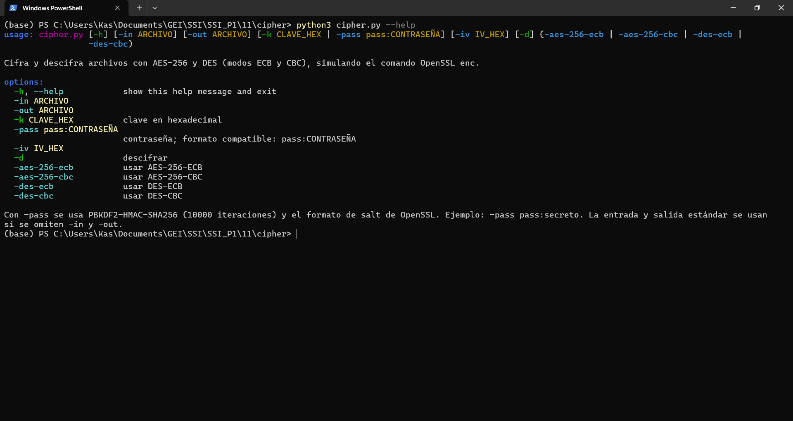
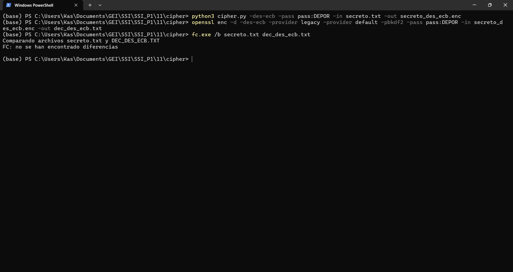
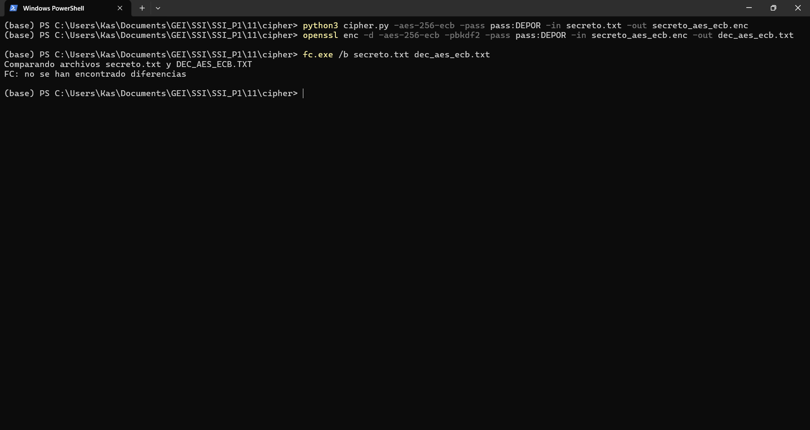
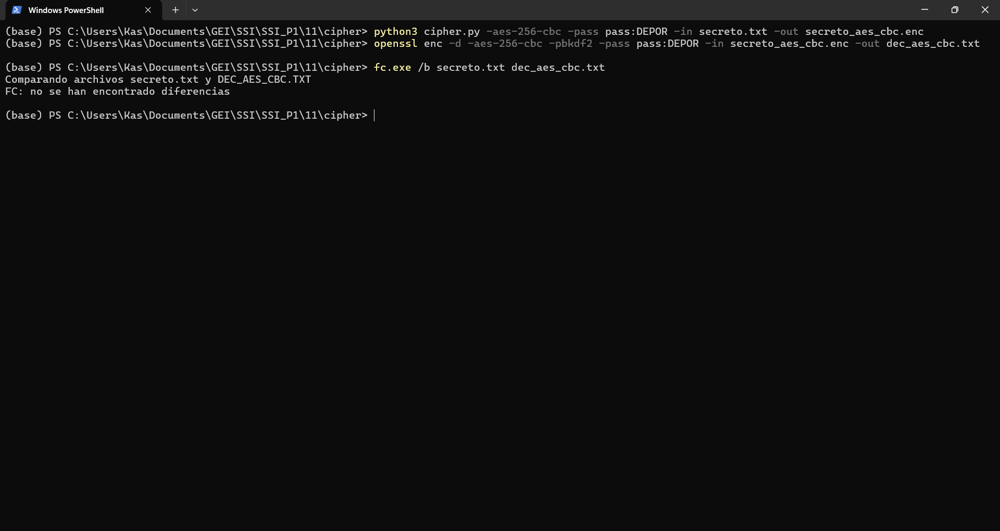

## Ejercicio 11

Utilizando el paquete PyCryptodome, implementad en Python un algoritmo que simule el funcionamiento de OpenSSL para los casos vistos en el ejercicio anterior.

### Apartado 11.a

El algoritmo debe poder ejecutarse desde una terminal, invocando al comando `cipher.py` y pasándole los argumentos y parámetros necesarios.

- El parámetro `--help` debe mostrar la sintaxis y las instrucciones de uso. Mostrad en la memoria una captura de pantalla que incluya la salida del comando con este parámetro.
- Guardad el código implementado para su posterior entrega en una carpeta denominada `cipher`.

#### Respuesta 11.a

* [x] Guardado el código fuente `cipher.py` en la carpeta `11/cipher` para su entrega con esta memoria <!-- CASILLA 11.a -->

<!-- INICIO RESPUESTA -->
Se ha usado la IA para dos funcionalidades por no ser parte del contenido de la asignatura:
- Parseo de argumentos.
- Derivación de clave (pbkdf2) para que sea igual a la opción `-pass` usada en el ejercicio 10.
##### Prompt
```txt
Modelo GPT-6 Luna:
Crea un codigo boilerplate para este ejercicio, solo debe contener:
entrada/salida (igual a openssl) con estas opciones
-in -out -k -iv -pass -aes-256-ecb -aes-256-cbc -des-ecb -des-cbc
--help con la sintaxis correspondiente
Tras ello implementa la funcion de derivación de clave que usa -pass
Dejame los huecos/funciones necesarios para implementar por mi cuenta cada uno de los 4 algoritmos
```
A continuación y para demostrar que se han adquirido los conocimientos se explicaran los conceptos fundamentales del funcionamiento del programa. No se ha usado IA en la redacción de esta parte.

Sin la opción `-pass` el funcionamiento es sencillo:
1. Se parsea el archivo, algoritmo, modo y si se quiere cifrar o descifrar.
2. Se pasan clave (e iv en caso de CBC) 
3. Con esto se llama a un diccionario de tuplas que tiene para cada algoritmo:
    - Función (a la que se tiene que llamar)
    - Bytes de clave (para comprobar que la longitud es correcta: 8 para DES y 36 para AES)
    - Bytes de iv (en caso de CBC 16 para AES y 8 para DES)
4. Se llama a la función que hace el cifrado/descifrado
5. Dentro de las funciones el mecanismo es el mismo:
    - Se crea la función de cifrado con el modo.
    - En caso de descifrado se descifra y se quita el padding .
    - En caso de cifrado se añade el padding (completar ultimo bloque) y se cifra.

Con la opcion `-pass` es necesario realizar una serie de operaciones adicionales:

**El "salt"**

Para que coincida con OpenSSL sus archivos cifrados llevan una cabecera:

`Salted__XXXXXXXX`

Esos 8 bytes aleatorios se generan antes de la funcion de cifrado y junto con la contraseña derivan una key y un iv (si fuese necesario). De este modo se evita que dos contraseñas generen el mismo par key/iv.

Al estar en la cabecera del archivo cifrado, la misma contraseña junto con el salt será rederivable en el par key/iv originales.

**La función de derivación**

El objetivo es simple: transformar una contraseña de texto en una clave (e iv de ser necesario) en formato hex de la longitud requerida para cada algoritmo (por ejemplo 36 y 16 para AES-CBC). 

Esa opción que usabamos en OpenSSL (`pkbdf2`) es el nombre de la funcion que vamos a usar `hashlib.pbkdf2_hmac()`. 

La función hashea usando sha256, 10000 iteraciones, contraseña y salt e indicandole la longitud requerida (por ejemplo 52 bytes, 36 key y 16 iv para aes-256-cbc) nos da los bytes que conformaran la clave y el vector de inicialización que usaremos para cifrar/descifrar.

**Opción help**



<!-- FIN RESPUESTA -->

### Apartado 11.b

Comprobad con la ayuda de CrypTool 1 o de OpenSSL, que vuestra implementación es correcta y mostrad evidencia de ello.

#### Respuesta 11.b

<!-- INICIO RESPUESTA -->

Se ha comprobado con OpenSSL que `cipher.py` es compatible: lo cifrado con `cipher.py` se descifra con OpenSSL. En cada caso se compara el resultado con el archivo original `secreto.txt` mediante `fc.exe /b`.

**DES-ECB**

**DES-CBC**

**AES-256-ECB**

**AES-256-CBC**


<!-- FIN RESPUESTA -->
